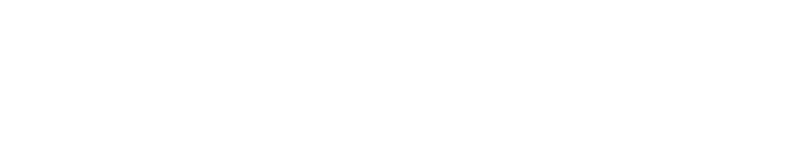

# Avatar Prefabs
Prefabs and assets that add **advanced animations and interactive systems** to **VRChat avatars**.

## Table of Contents

- [Avatar Prefabs](#avatar-prefabs)
  - [Better Blink Prefab](#better-blink-prefab)
  - [Eye Rotation Prefab](#eye-rotation-prefab)
  - [Logarithmic Gestures Prefab](#logarithmic-gestures-prefab)
  - [Face Tracking Prefab](#face-tracking-prefab)
  - [Pupil Dilation Prefab](#pupil-dilation-prefab)
  - [Pupil Focus System Prefab](#pupil-focus-system-prefab)
  - [Toe Curl System Prefab](#toe-curl-system-prefab)
  - [Raycast Floor Physbone Collider Prefab](#raycast-floor-physbone-collider-prefab)
  - [Raycast Wall Physbone Collider Prefab](#raycast-wall-physbone-collider-prefab)
  - [GoGo Loco Simplified Prefab](#gogo-loco-simplified-prefab)
  - [Ear Twitch Prefab](#ear-twitch-prefab)
- [Asset Prefabs](#asset-prefabs)
  - [Bell Sound System Prefab](#bell-sound-system-prefab)
  - [Heartbeat System Prefab](#heartbeat-system-prefab)
- [Components](#components)
  - [VRC Avatar Descriptor Enhancements](#vrc-avatar-descriptor-enhancements)
  - [VRCFury Full Controller](#vrcfury-full-controller)
  - [VRCFury Toggle](#vrcfury-toggle)
  - [VRC Remove Empty SubMenus](#vrc-remove-empty-submenus)
  - [VRC Contact Smoothing & VRC PhysBone Smoothing](#vrc-contact-smoothing--vrc-physbone-smoothing)
  - [VRC Face Tracking BlendShape Set](#vrc-face-tracking-blendshape-set)
  - [VRC Face Tracking BlendShape Set Hook](#vrc-face-tracking-blendshape-set-hook)
  - [VRC Face Tracking Parameter Behaviors](#vrc-face-tracking-parameter-behaviors)
  - [Mesh Blendshape Normals](#mesh-blendshape-normals)
  - [Rig Floor Adjuster](#rig-floor-adjuster)

## Better Blink Prefab

Adds a **smooth blink animation** driven by VRChat's eyelid data.

### Features
- **Without eye tracking**, VRChat's blinks are replaced with a smooth blink. Each blink has a **25% chance** of a double blink.
- **With eye tracking**, the tracked eyelids are used directly, so winks and squints come through.

### Instructions
1. Drag and drop the prefab into the avatar's hierarchy.
2. On the **VRC Avatar Descriptor**, set:
   - **Eye Look** enabled, with **Eyelid Type** set to `None`
   - **Face Tracking** enabled, with **Use All Tracking Keys** on
3. Use the **Output Animator Parameters** to drive animations.
4. Optionally, add an expression parameter and toggle for `BlinkActive` to disable blinking.
5. Optionally, use the **Input Animator Parameters** for interactions like eye pokes.

### Optional Expression Parameters

| Property | Animator Type | Expression Type | Synced | Description |
|-|-|-|-|-|
| BlinkActive | Bool | Bool | ✔ | Blinking toggle; on by default |

### Output Animator Parameters

| Property | Animator Type | Description |
|-|-|-|
| VAP/BlinkLeft | Float | Left blink; `1` is closed |
| VAP/BlinkRight | Float | Right blink; `1` is closed |
| EyeLidLeft | Float | `(1 - EyeClosedLeft) * 0.75 + EyeWideLeft * 0.25`; `0` is closed, `0.75` is open and `1` is wide |
| EyeLidRight | Float | `(1 - EyeClosedRight) * 0.75 + EyeWideRight * 0.25`; `0` is closed, `0.75` is open and `1` is wide |

### Input Animator Parameters

| Property | Animator Type | Description |
|-|-|-|
| VAP/BlinkLeftOverride | Float | Applied to `VAP/BlinkLeft` when not blinking |
| VAP/BlinkRightOverride | Float | Applied to `VAP/BlinkRight` when not blinking |
| UserEyeTracking | Bool | Built-in VRChat parameter |

---

## Eye Rotation Prefab

> Works with the **Face Tracking Prefab** for the eye tracking toggle and **Eye Sensitivity**.

Rotates the eyes from VRChat's eye look data, with **eye bones** and **eye blendshapes**.

### Features
- **Eye bones** rotate for both built-in gaze and eye tracking.
- **Eye Sensitivity** only applies to eye tracking, leaving built-in gaze untouched.
- **Eyelids** follow the eyes through these `Body` blendshapes:
  - `EyeLookUpLeft`, `EyeLookDownLeft`, `EyeLookInLeft`, `EyeLookOutLeft`
  - `EyeLookUpRight`, `EyeLookDownRight`, `EyeLookInRight`, `EyeLookOutRight`
- **Rotate blendshapes** on `Body`, blended for diagonal looks:
  - `EyeLookUpLeftRotate`, `EyeLookDownLeftRotate`, `EyeLookInLeftRotate`, `EyeLookOutLeftRotate`
  - `EyeLookUpRightRotate`, `EyeLookDownRightRotate`, `EyeLookInRightRotate`, `EyeLookOutRightRotate`

### Instructions
1. Drag and drop the prefab into the avatar's hierarchy.
2. On the **VRC Avatar Descriptor**, set:
   - **Eye Look** enabled, with:
     - **Left Eye Bone** and **Right Eye Bone** set to `None`, since the prefab rotates them
     - **Eye Gaze Mode** set to `Face Tracking`
   - **Face Tracking** enabled, with **Use All Tracking Keys** on
3. Adjust `Eye Down-Up` and `Eye In-Out` under the rig's **Muscles & Settings**.

### Input Animator Parameters

| Property | Animator Type | Description |
|-|-|-|
| EyeLeftX | Float | Set by the prefab: `EyeLookInLeft - EyeLookOutLeft` |
| EyeRightX | Float | Set by the prefab: `EyeLookOutRight - EyeLookInRight` |
| EyeY | Float | Set by the prefab: `(EyeLookUpLeft + EyeLookUpRight - EyeLookDownLeft - EyeLookDownRight) / 2` |
| UserEyeTracking | Float | `1` while the user's own eye tracking is active; required for **Eye Sensitivity** |
| UserEyeTrackingSensitivity | Float | **Eye Sensitivity** from the **Face Tracking Prefab**; `0` is 1× and `1` is 2× |
| VAP/EyeLook/EaseOut | Float | Optional; `1` turns off all `EyeLook*` blendshapes |
| VAP/EyeLook/LeftVerticalEaseOut | Float | Optional; `1` turns off the left eye's up/down `EyeLook*` blendshapes |
| VAP/EyeLook/RightVerticalEaseOut | Float | Optional; `1` turns off the right eye's up/down `EyeLook*` blendshapes |
| Derp | Float | Optional; `1` makes the eyes silly, turning both outward with the left looking up and the right looking down; ignores **Eye Sensitivity** |

### Output Animator Parameters

| Property | Animator Type | Description |
|-|-|-|
| VAP/EyeLeftX | Float | Left eye horizontal look, with sensitivity |
| VAP/EyeRightX | Float | Right eye horizontal look, with sensitivity |
| VAP/EyeLeftY | Float | Left eye vertical look, with sensitivity |
| VAP/EyeRightY | Float | Right eye vertical look, with sensitivity |

> **Warning:** With **Eye Sensitivity**, these outputs range from `-2` to `2`. Use **1D or 2D blend trees**, which stop at their outermost motions, not **Direct blend trees**, which would overdrive the motion up to 2×.

---

## Logarithmic Gestures Prefab

Adds **smoothed gesture values** for blend trees.

### Instructions
1. Drag and drop the prefab into the avatar's hierarchy.
2. Use the **Output Animator Parameters** to drive animations.
3. Optionally, add gesture overrides to the expression menu with `VAP Logarithmic Gestures Override Parameters`, `VAP Logarithmic Gestures Override Left Menu` and `VAP Logarithmic Gestures Override Right Menu`.

### Included Expression Parameters

| Property | Animator Type | Expression Type | Synced | Description |
|-|-|-|-|-|
| QuestControllers | Float | Boolean  | ✔ | Add with VRCFury to disable victory gestures & trigger weights

### Optional Expression Parameters

| Property | Animator Type | Expression Type | Synced | Description |
|-|-|-|-|-|
| GestureLeftOverride | Float | Integer | ✔ | Overrides the left gesture from the included menu |
| GestureRightOverride | Float | Integer | ✔ | Overrides the right gesture from the included menu |

### Output Animator Parameters

| Property | Animator Type | Description |
|-|-|-|
| VAP/GestureLeft | Float | Current left gesture |
| VAP/GestureRight | Float | Current right gesture |
| VAP/GestureLeft/Weight | Float | Smoothed left gesture weight |
| VAP/GestureRight/Weight | Float | Smoothed right gesture weight |
| VAP/GestureLeft/[Gesture] | Float | Smoothed value per left gesture: `Idle`, `Fist`, `Open`, `Point`, `Victory`, `Rock&Roll`, `Gun` and `ThumbsUp` |
| VAP/GestureRight/[Gesture] | Float | Smoothed value per right gesture: `Fist`, `Open`, `Point`, `Victory`, `Rock&Roll`, `Gun` and `ThumbsUp` |

---

## Face Tracking Prefab

> Works with the **Better Blink Prefab**, **Eye Rotation Prefab** & **Pupil Focus System Prefab**.

VRChat drives and smooths the **Unified Expressions** blendshapes through the descriptor's **Blendshapes Sets**, so this prefab only handles the rest.

### Features
- Uses `13 synced bits`.
- **Eye Tracking** toggle.
- **Lip Tracking** toggle.
- **Disable Gestures** toggle to turn off gesture expressions while tracking.
- **Brow & Squint Emulation** for headsets without brow or squint tracking.
- **Eyelids** follow the tracked eyelids with eye tracking on, or the **Better Blink Prefab** with it off.
- **Pupil Dilation** uses tracked dilation with **Dilation Tracking** on. **Pupil Dilation Emulation** (on by default) emulates it from expressions and the **Pupil Focus System Prefab** if installed. Both can be combined.
- **Visemes Sensitivity** scales the `Visemes` Blendshapes Set. **Expressive** is full, **Lively** is 2/3 (default), **Subtle** is 1/3 and **Still** is 0.
- **Eye Sensitivity** scales eye look from **1×** to **2×** (default `0.6`) while the user's own eye tracking is active. Used by the **Eye Rotation Prefab**.
- **Mouth Corrections** for your `FaceTracking` Blendshapes Set.
- **Corrective Blendshape** behaviors are generated automatically for any blendshape named after two main Body blendshapes followed by `Corrective`.

### Instructions
1. Drag and drop the prefab into the avatar's hierarchy.
2. Name the face blendshapes exactly as VRChat's [tracking keys](https://vrc-beta-docs.netlify.app/avatars/face-tracking/osc) (ex. `JawOpen`, `EyeClosedLeft`).
3. On the **VRC Avatar Descriptor**, set:
   - **LipSync** > **Mode** to `Viseme Blend Shape Face Tracking`
   - **Eye Look** enabled, with **Eye Gaze Mode** set to `Face Tracking` and **Eyelid Type** set to `None`
   - **Face Tracking** enabled, with **Use All Tracking Keys** on, your face mesh in **Face Tracking Mesh**, and (recommended) **Viseme Dampen** set to `Dampen Visemes` with **Dampen Amount** `1`
4. Create the **Blendshapes Sets** (under **Face Tracking**):
   - `FaceTracking`: only your mouth-related blendshapes (jaw, mouth, lips, cheeks, tongue).
   - `EyeTracking`: your eye & brow blendshapes. With the **Eye Rotation Prefab**, leave out the `EyeLook*` blendshapes, since it drives them itself.
   - `Visemes`: your viseme blendshapes. **Visemes Sensitivity** controls its weight.
5. The prefab doesn't enable or disable these Blendshapes Sets, so do it yourself from the toggles:
   - Turn the `EyeTracking` Blendshapes Set on and off with the **Eye Tracking** toggle (the `EyeTrackingActive` parameter).
   - Turn the `FaceTracking` Blendshapes Set on and off with the **Lip Tracking** toggle (the `LipTrackingActive` parameter).
6. Optionally, add corrective blendshapes named `[Blendshape][Blendshape]Corrective` (ex. `MouthClosed` + `LipPucker` → `MouthClosedLipPuckerCorrective`). The **Blendshape** tab of the prefab's **VRC Face Tracking Parameter Behaviors** lists them under **Generate Correctives Based on Tracking Keys** and lets you uncheck any.
7. Optionally, use the **Output Animator Parameters** to drive other animations (ex. ears) from a separate FX controller.

### Included Expression Parameters

| Property | Animator Type | Expression Type | Synced | Description |
|-|-|-|-|-|
| EyeTrackingActive | Float | Boolean | ✔ | Eye tracking toggle |
| LipTrackingActive | Float | Boolean | ✔ | Lip tracking toggle |
| FT/EyeDilationEnabled | Float | Boolean | ✔ | Tracked pupil dilation toggle |
| FT/FacialExpressionsDisabled | Float | Boolean | ✔ | Disable Gestures toggle |
| FT/FaceTrackingEmulation | Float | Boolean | ✔ | Brow & squint emulation toggle; on by default |
| FT/EyeDilationEmulation | Float | Boolean | ✔ | Pupil dilation emulation toggle; on by default |
| UserEyeTrackingSensitivity | Float | Float | ✔ | **Eye Sensitivity**; `0` is 1× and `1` is 2× |
| VisemesSensitivity | Int | Int | ✔ | **Visemes Sensitivity**; `0` is full, `1` is 2/3 (default), `2` is 1/3 and `3` is 0 |
| FT/State/TrackingActive | Float | Boolean | ✖ | Whether tracking was on, so gestures only switch when tracking is toggled |

### Input Animator Parameters

| Property | Animator Type | Expression |
|-|-|-|
| VAP/FT/EyeSquintLeftForward | Float | `EyeSquintLeft` |
| VAP/FT/EyeSquintRightForward | Float | `EyeSquintRight` |
| VAP/FT/BrowExpressionLeftForward | Float | `BrowInnerUpLeft - BrowLowererLeft` |
| VAP/FT/BrowExpressionRightForward | Float | `BrowInnerUpRight - BrowLowererRight` |
| VAP/FT/PupilDilationForward | Float | `(EyeDilationLeft + EyeDilationRight - EyeConstrictLeft - EyeConstrictRight) / 4 + 0.5` |
| EyeLidLeft | Float | From the **Better Blink Prefab** |
| EyeLidRight | Float | From the **Better Blink Prefab** |
| VAP/BlinkLeft | Float | From the **Better Blink Prefab** |
| VAP/BlinkRight | Float | From the **Better Blink Prefab** |
| Touch/PupilFocus | Float | From the **Pupil Focus System Prefab** |

### Output Animator Parameters

| Property | Animator Type | Description |
|-|-|-|
| VAP/FT/EyeLidLeft | Float | Left eyelid; `0` is closed, `0.75` is open and `1` is wide |
| VAP/FT/EyeLidRight | Float | Right eyelid; `0` is closed, `0.75` is open and `1` is wide |
| VAP/FT/EyeSquintLeft | Float | Left squint, tracked or emulated |
| VAP/FT/EyeSquintRight | Float | Right squint, tracked or emulated |
| VAP/FT/BrowExpressionLeft | Float | Left brow, tracked or emulated; `1` is raised and `-1` is lowered |
| VAP/FT/BrowExpressionRight | Float | Right brow, tracked or emulated; `1` is raised and `-1` is lowered |
| VAP/FT/PupilDilation | Float | Pupil dilation, tracked or emulated |
| VAP/FT/Smile | Float | Combined smile; `1` is a smile and `-1` is a frown |
| VAP/FT/Brow | Float | Combined brows; `1` is raised and `-1` is lowered |
| VAP/FT/Angry | Float | Combined anger; `1` is a lowered brow with nose sneer |
| VAP/FT/NoseSneer | Float | `(NoseSneerLeft + NoseSneerRight) / 2` |
| VAP/FT/SmileFrownLeft | Float | `max(MouthCornerPullLeft, MouthCornerSlantLeft * 0.3) - MouthFrownLeft` |
| VAP/FT/SmileFrownRight | Float | `max(MouthCornerPullRight, MouthCornerSlantRight * 0.3) - MouthFrownRight` |
| VAP/FT/MouthRaiserLower | Float | `MouthRaiserLower` |
| VAP/FT/MouthX | Float | `(MouthUpperRight + MouthLowerRight - MouthUpperLeft - MouthLowerLeft) / 2` |
| VAP/FT/JawX | Float | `JawRight - JawLeft` |
| VAP/FT/JawOpen | Float | `JawOpen` |
| VAP/FT/TongueOut | Float | `TongueOut` |
| VAP/FT/TongueX | Float | `TongueRight - TongueLeft`, limited to `±(0.5 + TongueOut * 0.5)` |
| VAP/FT/TongueY | Float | `TongueUp - TongueDown`, limited by how far the tongue is out |
| VAP/FT/TongueTwist | Float | `TongueTwistRight - TongueTwistLeft` |

---

## Pupil Dilation Prefab

Combines **pupil dilation** from three sources into one value per eye:
- **User dilation** set per eye (ex. from the **Expression Menu**).
- **Input dilation** (ex. from **gestures** or **face tracking**).
- **Closed eye dilation** that builds up while an eye is closed.

### Instructions
1. Drag and drop the prefab into the avatar's hierarchy.
2. Feed the input parameters below, and optionally the user dilation parameters, from your animator, menu or VRC Face Tracking Parameter Behaviors. The prefab doesn't set them.
3. Use the **Output Animator Parameters** to drive animations.

### Optional Expression Parameters

| Property | Animator Type | Expression Type | Synced | Description |
|-|-|-|-|-|
| LeftDilationSet | Float | Float | Optional | Left eye user dilation; `0` is small, `0.25` is default and `1` is high |
| RightDilationSet | Float | Float | Optional | Right eye user dilation; `0` is small, `0.25` is default and `1` is high |

### Output Animator Parameters

| Property | Animator Type | Description |
|-|-|-|
| VAP/Pupil/LeftDilation | Float | Combined left pupil dilation |
| VAP/Pupil/RightDilation | Float | Combined right pupil dilation |

### Input Animator Parameters

| Property | Animator Type | Description |
|-|-|-|
| VAP/Pupil/DilationSmoothedInput | Float | Input dilation |
| VAP/Pupil/LeftEyeClosedInput | Float | Left eye closed amount; above `0.9` adds closed eye dilation |
| VAP/Pupil/RightEyeClosedInput | Float | Right eye closed amount; above `0.9` adds closed eye dilation |

---

## Pupil Focus System Prefab

Adds a **Face Proximity contact receiver** that constricts the pupils when something nears the face.

### Instructions
1. Drag and drop the prefab into the avatar's hierarchy.
2. Place the contact receiver in front of the face, between the eyes.
3. Use the **Output Animator Parameters** to drive animations.

### Output Animator Parameters

| Property | Animator Type | Description |
|-|-|-|
| VAP/Touch/PupilFocus | Float | Smoothed face proximity |
| Touch/PupilFocus | Float | Raw face proximity |

---

## Toe Curl System Prefab

Adds **toe curls** with two contact sensors and two rotation constraints.

### Instructions
1. Drag and drop the prefab into the avatar's hierarchy.
2. Add an empty game object with no offset to each **foot** (ex. `Curl_L` and `Curl_R`).
3. On `Left Curl`, set the contact sensor's `Root Transform` and the rotation constraint's `Target Transform` to `Curl_L`.
4. On `Right Curl`, set the contact sensor's `Root Transform` and the rotation constraint's `Target Transform` to `Curl_R`.
5. Set the rotation constraints' `Source Transform` to each **foot**, so the contact sensors don't rotate.

### Output Animator Parameters

| Property | Animator Type | Description |
|-|-|-|
| Touch/FootLCurl | Float | Raw left toe curl proximity |
| Touch/FootRCurl | Float | Raw right toe curl proximity |

---

## Raycast Floor Physbone Collider Prefab

Sets the floor PhysBone collider with a raycast.

### Features
- Synced, saved `bool` toggle for the floor collider. On by default.

### Instructions
1. Drag and drop the prefab into the avatar's hierarchy.
2. Add **Floor Physbone Collider** to the **Colliders** of any PhysBones that should hit the floor.

### Included Expression Parameters

| Property | Animator Type | Expression Type | Synced | Description |
|-|-|-|-|-|
| FloorCollider | Bool | Bool | ✔ | Floor collider toggle |

---

## Raycast Wall Physbone Collider Prefab

Sets the wall PhysBone collider with 2 raycasts aiming left and right.

### Features
- Synced `bool` toggle for the wall collider. Off by default for performance.

### Instructions
1. Drag and drop the prefab into the avatar's hierarchy.
2. Add **Wall Physbone Collider** to the **Colliders** of any PhysBones that should hit walls.

### Included Expression Parameters

| Property | Animator Type | Expression Type | Synced | Description |
|-|-|-|-|-|
| WallCollider | Bool | Bool | ✔ | Wall collider toggle |

---

## GoGo Loco Simplified Prefab

**GoGo Loco controllers and menus**, simplified and improved.

### Features
- Fixes the **Index controller finger tracking issue**
- **Feral movement animations** toggle
- Simplified **menu options**

### Instructions
1. Drag and drop the prefab into the avatar's hierarchy.
2. Requires GoGo Loco `1.8.6` in the project.

---

## Ear Twitch Prefab

Adds **ear twitches** at random intervals.

### Instructions
1. Drag and drop the prefab into the avatar's hierarchy.
2. Use the **Output Animator Parameters** to drive animations.
3. Optionally, add an expression parameter and toggle for `EarTwitchActive` to disable twitches.

### Included Expression Parameters

| Property | Animator Type | Expression Type | Synced | Description |
|-|-|-|-|-|
| EarTwitchLeft | Bool | Bool | ✔ | Syncs the left ear twitch |
| EarTwitchRight | Bool | Bool | ✔ | Syncs the right ear twitch |

### Optional Expression Parameters

| Property | Animator Type | Expression Type | Synced | Description |
|-|-|-|-|-|
| EarTwitchActive | Bool | Bool | ✖ | Ear twitch toggle |

### Output Animator Parameters

| Property | Animator Type | Description |
|-|-|-|
| VAP/Ear/Left_Twitch | Float | Left ear twitch |
| VAP/Ear/Right_Twitch | Float | Right ear twitch |

Both are `10` during a twitch, to override other animations in a direct blend tree.

###
# Asset Prefabs

## Bell Sound System Prefab

Adds **movement-based bell sounds** to an asset.

### Instructions
1. Drag and drop the prefab into the asset's hierarchy.
2. Attach **Bell Sound** with a **VRCFury Armature Link**. It attaches at the root of the selected game object.
3. The included **PhysBone** is a sample and can be changed or replaced.
4. The included **Chest Collider** stops the bell clipping into the chest. Remove it if not needed.

---

## Heartbeat System Prefab

Adds a **heartbeat sound and visual display**.

### Features
- Synced `float (7 bits)` shared by the Expression Menu and OSC.
- Synced `bool (1 bit)` toggling the heart rate counter.

### Instructions
1. Drag and drop the prefab into the avatar's hierarchy.
2. Place **Heartbeat Sound** at the chest.
3. Place **Heartbeat Counter** over the **left hand**, or remove its **VRCFury Armature Link** to attach it elsewhere.

---

# Components

Components added from **Add Component** > **VAP**. They are applied when the avatar is built and are removed from the uploaded avatar.

> Requires [NDMF](https://ndmf.nadena.dev) and [VRCFury](https://vrcfury.com).

Components that only work once per avatar can still be added more than once. The one closest to the avatar root is used, and the others say so in their inspector.

On a prefab instance, locked components show an **Edit in Prefab** button. Components outside an avatar show a warning at the bottom of the inspector.

## VRC Avatar Descriptor Enhancements

Adds extra settings for the avatar's own **VRC Avatar Descriptor**. Add it to the avatar root, one per avatar.

### Features
- **Menu**: change parameter defaults and remove menu items of the descriptor's **Expressions Menu** and **Expression Parameters**. The assets are never changed; a copy is edited at build time. Right-click an item to remove it.
- **Frame Time**: adds the frame time parameters to the avatar (see [Frame Time](#frame-time)).
- **Play Audio Clips**: sets the clips of every **VRC Animator Play Audio** behaviour in the descriptor's playable layers, without changing the controllers.

## VRCFury Full Controller

A **VRCFury Full Controller** with the same **Menu**, **Frame Time** and **Play Audio Clips** sections as the [VRC Avatar Descriptor Enhancements](#vrc-avatar-descriptor-enhancements), applied to the controllers, menus and parameters of that Full Controller.

### Instructions
1. Add **VAP** > **VRCFury Full Controller**, or right-click an existing **VRCFury** Full Controller and pick **Wrap with VAP**.
2. Set it up in the **VRCFury** section like a normal Full Controller.
3. Use **Unwrap** from the component menu to go back to a plain VRCFury component. Menu overrides are lost.

## VRCFury Toggle

A **VRCFury Toggle** with the ability to override the **Default** value it starts at.

### Instructions
1. Add **VAP** > **VRCFury Toggle**, or right-click an existing **VRCFury** Toggle and pick **Wrap with VAP**.
2. Set it up in the **VRCFury** section like a normal Toggle.
3. **Default** can be changed on prefab instances. Right-click it to revert.

## VRC Remove Empty SubMenus

Removes every sub menu control of the avatar's menu that ends up with nothing inside at build time.

## VRC Contact Smoothing & VRC PhysBone Smoothing

Smooths one parameter of a **VRC Contact Receiver** or a **VRC PhysBone** on the same game object, and writes it to an output parameter. All smoothings are built into one generated **VAP Smoothing** layer that also holds the [Frame Time](#frame-time).

### Instructions
1. Add **VAP** > **VRC Contact Smoothing** next to a **VRC Contact Receiver**, or **VAP** > **VRC PhysBone Smoothing** next to a **VRC PhysBone**.
2. Pick the **Contact Parameter** or **PhysBone Parameter** (`_IsGrabbed`, `_IsPosed`, `_Angle`, `_Stretch` or `_Squish`).
3. Pick the **Smoothing Factor**. Click the chain icon to set separate **Rise Factor** and **Drop Factor**; either can be `None` to follow the input directly.
4. Use the **Output Parameter**  to drive animations.

### Settings
| Setting | Description |
|-|-|
| Smoothing Factor | `Touch` (8), `Gesture` (20) or `Custom`; higher follows faster |
| Passes | `Double` smooths through an extra hidden step for a softer curve, `Single` moves straight toward the input |
| Output Parameter | Receives the smoothed value |
| Transform Output | Maps the smoothed value (X) and a second parameter (**Y Parameter**) to the output with a 2D blend. Drag the points in the graph or edit them in the list. The default points multiply the two. **Apply Before Smoothing** blends the raw input instead, so the result is what gets smoothed |
| Timer | Counts, in seconds, how long the input is above `0`, in the **Timer Parameter** (output followed by `Timer` if empty) |

Each input can only be smoothed once, and an output or timer name used by two smoothings stops the build.

### Frame Time

Added when any smoothing exists, or when **Frame Time** is turned on in a [VRC Avatar Descriptor Enhancements](#vrc-avatar-descriptor-enhancements) or [VRCFury Full Controller](#vrcfury-full-controller). Animators can use these parameters, and each Full Controller gets the ones its animators use as globals.

| Property | Animator Type | Description |
|-|-|-|
| VAP/Smooth/Touch | Float | Smoothing factor for touch, speed `8` |
| VAP/Smooth/Gesture | Float | Smoothing factor for gestures, speed `20` |
| VAP/Smooth/StepSizeOne | Float | Seconds since the last frame, for counting time |

Custom factors can be added in the **Frame Time** section, named after the parameter your animators use. They don't need to be global. At build time, matching parameters in that component's animators are renamed to `VAP/Smooth/Speed<value>` for **Smoothing** or `VAP/Smooth/Linear<value>` for **Linear**, and made global.

## VRC Face Tracking BlendShape Set

Adds a **Blendshapes Set** to the avatar descriptor's **Face Tracking** at build time, so prefabs can bring their own. It has the same settings as the descriptor's Blendshapes Sets. Its name can't be used by another set on the avatar.

**Auto-Fill Format** fills the set from blendshapes named after the tracking keys. `*` is the key name (`*Debug` maps `JawOpen` to `JawOpenDebug`); leave it empty to turn auto-fill off.

## VRC Face Tracking BlendShape Set Hook

Renames blendshapes named after tracking keys in a format (ex. `JawOpenHook`) on the listed **Face Tracking Meshes** to the blendshape the **Target Blendshapes Set** uses for that key, so they move with it. Keys the target set leaves empty only lose the format (ex. `MouthClosedHook` becomes `MouthClosed`).

## VRC Face Tracking Parameter Behaviors

Adds **Parameter Behaviors** to the avatar descriptor's **Face Tracking** at build time. A shared **Blendshapes Set** is used by every behavior unless **Per Behavior** is on.

### Features
- **Animator**, **Blend Set** and **Blendshape** tabs hold normal Parameter Behaviors.
- **Tracking Key** tab limits (Max or Min) every blendshape a Blendshapes Set uses for a tracking key or a group of keys (ex. `LipFunnel`).
- **Generate Correctives Based on Tracking Keys** (on by default, under the **Blendshape** tab) adds behaviors for blendshapes on the face tracking meshes named after two of the set's blendshapes followed by `Corrective` or `Morph` (ex. `MouthClosedLipPuckerCorrective`), driven by both. Uncheck any to leave it out.
- **Copy All** and **Paste** copy behaviors between components.

## Mesh Blendshape Normals

Recalculates the normals and tangents of the listed **Blendshapes** at build time, the way Blender shades them. Leave **Mesh** empty to use every mesh in the avatar that has them.

## Rig Floor Adjuster

Moves the armature and the view position up or down by **Armature Height Offset** (in meters) at build time, and rebuilds the humanoid avatar to match. One per avatar.
